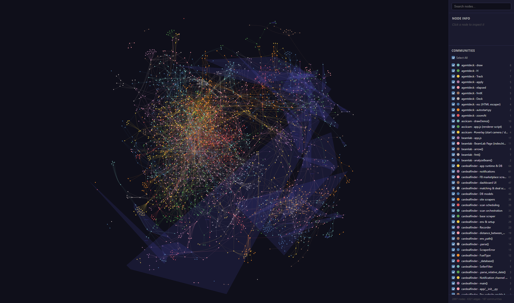

# graphify-showcase



One knowledge graph across my public GitHub repos, built with [graphify](https://github.com/safishamsi/graphify):
every function, class, file and doc node, AST-extracted, community-detected, merged cross-repo.

**2,897 nodes · 6,321 edges · 187 communities · 13 repos**

Open [`graph.html`](graph.html) locally for the interactive map (search, click-to-inspect, filter by community).
`graph.json` is the raw NetworkX node-link graph; every node carries a `repo` attribute.

## Repos in the map

| Repo | Nodes |
|---|---|
| [goldtracker](https://github.com/savage20021/goldtracker) | 1,515 |
| [cardealfinder](https://github.com/savage20021/cardealfinder) | 597 |
| [metastrip](https://github.com/savage20021/metastrip) | 192 |
| [fileconverter](https://github.com/savage20021/fileconverter) | 158 |
| [hikari](https://github.com/savage20021/hikari) | 89 |
| [wordle-solver](https://github.com/savage20021/wordle-solver) | 75 |
| [minesweeper-solver](https://github.com/savage20021/minesweeper-solver) | 57 |
| [trusslab](https://github.com/savage20021/trusslab) | 53 |
| [agentdeck](https://github.com/savage20021/agentdeck) | 49 |
| [beamlab](https://github.com/savage20021/beamlab) | 45 |
| [savage20021](https://github.com/savage20021/savage20021) | 25 |
| [asciicam](https://github.com/savage20021/asciicam) | 22 |
| [profile-cards](https://github.com/savage20021/profile-cards) | 20 |

## Rebuild

`build.py` filters the private all-projects merge down to the public repos, re-renders `graph.html`, and
screenshots `map.png` with headless Chrome:

```
python build.py --png
```
